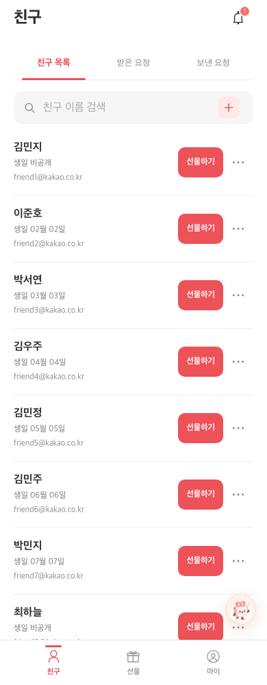
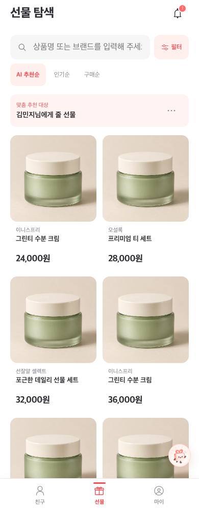
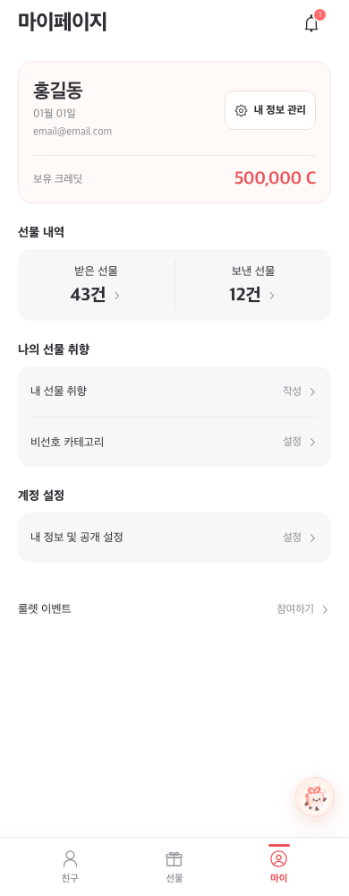
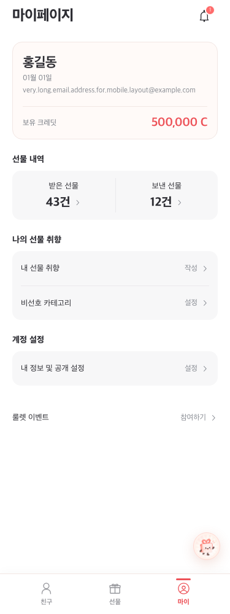

# 모바일 메인 화면 리디자인 — 2026-10-22

## 현재 구조와 변경 범위

FSD 구조의 `pages`가 화면을, `features`가 필터·요청 등의 사용자 동작을, `shared/ui`가 헤더·설정 행·상태 표시를 담당한다. 이번 변경은 화면의 표현과 CSS에 한정한다. `entities`의 API와 비즈니스 로직, `app`의 라우팅, 보호된 `mobile` 런타임은 수정하지 않는다.

| 대상                                                 | 기존 문제                                      | 변경                                                                                                                                |
| ---------------------------------------------------- | ---------------------------------------------- | ----------------------------------------------------------------------------------------------------------------------------------- |
| `pages/gifts/ui/GiftBrowsePages.tsx`                 | 검색·정렬의 시각적 분산, 브랜드·가격 위계 부족 | 검색·필터를 한 줄로, 정렬을 선택형 버튼으로 정리. 정사각 이미지·2열 그리드 유지, 브랜드보다 가격 강조. 추천 대상 표시와 더보기 분리 |
| `pages/friends/ui/FriendsPage.tsx`에 적용되는 CSS    | 112px 이상의 카드와 세로로 배치된 보조 동작    | 일반 이름 기준 약 96px 행, 이름→생일→이메일 위계. 선물하기·더보기를 가로 배치. 세 탭은 밑줄과 코랄 선택 표시                        |
| `pages/profile/ui/ProfilePages.tsx`                  | 프로필 아래 56px 여백, 동일한 메뉴 5개 나열    | 프로필과 크레딧 분리. 선물 내역 2열 요약, 취향 메뉴, 계정 설정의 세 그룹. 기존 설정 행과 5개 이동 유지                              |
| `features/filter-products/ui/ProductFilterSheet.tsx` | 필터 선택 상태의 요약 부족                     | 현재 선택 개수 표시, 선택 항목 코랄 강조, 최소 44px 항목 높이                                                                       |
| `prototype.css`의 메인 화면·하단 내비게이션          | 반복 테두리·그림자, 화면별 밀도 차이           | 메인 화면 좌우 20px, 경계선 최소화, 불투명 하단 내비게이션과 선택 표시 통일                                                         |

상품명 문자열, 13px 글꼴 크기, 1.25 줄 높이, 최소 32px 영역과 줄바꿈·말줄임 정책은 그대로 유지한다. 상품명 변경이나 새 라이브러리 도입은 없다.

## 레퍼런스 확인

웹 문서 추출은 JavaScript 앱 안내만 반환했지만, 브라우저에서 네 프로젝트의 실제 이미지를 확인했다. 원본 이미지·아이콘·브랜드 색상을 복제하거나 가져오지 않았다.

- [올리브영 모바일 웹 리디자인](https://notefolio.net/hani444/448805): 제품 중심의 2열 그리드와 목록 바로 위 정렬·필터 배치를 확인했다. 선잘알에서는 큰 광고 영역을 추가하지 않고 목록 도구를 조밀하게 배치한다.
- [Coupang UI/UX Redesign](https://notefolio.net/kihongkim/294873): 검색 진입과 탐색 메뉴를 구분하는 화면 및 단순한 아이콘·목록 구성을 확인했다. 검색·필터의 인접 배치와 절제된 시각 요소를 참고한다.
- [비트윈 리디자인](https://notefolio.net/kimyohada2262979/389383): 관계·선물 맥락의 섹션 및 카드 구성을 확인했다. 친구 목록 전용 레이아웃으로 단정하지 않으며, 친구 화면은 사용자 요구의 이름·생일·이메일 위계를 우선한다.
- [MUJI passport 리디자인](https://notefolio.net/hjkim/76462): 마이페이지 상단 개인 요약과 하단 메뉴 구분을 확인했다. 선잘알에서는 프로필·크레딧과 선물·취향·계정 영역을 구분한다.

## 기능 보존 및 검증

- 로딩·빈 목록·오류·재시도는 기존 `InfiniteCursor`·`AsyncContentState`를 유지한다.
- 상품 검색의 debounce, 필터 선택·초기화·적용, 정렬 값, 추천 대상 선택·변경·해제는 기존 동작을 유지한다.
- 친구 요청·수락·거절·취소·삭제와 기존 확인 모달을 유지한다.
- 친구 삭제는 더보기 메뉴 안에 유지한다. 생일 비공개도 그대로 표시한다.
- 마이페이지의 내 정보 관리·선물 내역·취향·비선호·계정 화면 이동을 유지한다.
- 기존 상품·프로필의 긴 이메일 레이아웃 테스트와 함께 320px·390px·데스크톱 기기 미리보기의 구조·터치 영역·상품명 규칙 회귀 테스트를 추가한다.
- 받은 선물 건수를 8건으로 고정했던 프로필 테스트는 현재 데이터와 무관하게 이동을 검증하도록 숫자 패턴으로 변경한다. 실제 건수나 mock 데이터는 바꾸지 않는다.

실제 모바일 하드웨어와 운영 API·S3 권한은 이번 검증 대상이 아니다. 리디자인은 로컬 브랜치 `feat/mobile-ui-polish`에서 진행하며 운영 배포는 하지 않는다.

### 실행 결과

- 빌드·타입 검사 및 보호 런타임 28개 무결성 검사 통과.
- 화면/기존 UI 흐름 테스트 49개를 확인했다. 새 필터 테스트의 닫힘 애니메이션 대기를 보완했고, 최종 반응형·긴 이메일·필터 테스트 10개는 모두 통과했다. 나머지 친구·프로필·선물·플로팅 흐름 39개도 통과했다.
- API 형식 응답을 사용하는 친구 요청·삭제 테스트 10개 통과.
- 추천 API 테스트 10개 중 최종 실행에서 8개 통과, 2개는 수신자 시트의 동일 친구 중복으로 선택자가 여러 행을 찾는 간헐 오류가 발생했다. 변경 전 develop을 별도 디렉터리에 복사해 같은 테스트를 실행했을 때도 동일한 중복 키 31·32와 선택자 오류가 재현됐다. 이번 UI 변경에서 API/목록 로직은 수정하지 않았다.
- 변경 파일 ESLint 오류 없음. 기존 effect 내 상태 변경 경고 2개는 유지했다. Prettier와 git diff 공백 검사 통과.
- 목업 미리보기에서 세 메인 화면을 확인했다. 운영 API, 실제 기기 및 S3 접근 권한 검증은 포함하지 않는다.

## 전체 화면 확장

후속 요청에 따라 기존 메인 3개 화면과 동일한 표현 규칙을 나머지 12개 경로 및 공통 시트·모달에 적용했다. API·상태 관리·결제·가입 처리·라우팅은 변경하지 않았다.

| 화면/영역                       | 개선 내용                                                         | 보존 사항                                                               |
| ------------------------------- | ----------------------------------------------------------------- | ----------------------------------------------------------------------- |
| 로그인                          | 화이트 바탕, 상단 브랜드·입력 폼 구분, 입력값과 라벨 굵기 분리    | 검증·오류·비밀번호 표시·로그인/가입 이동                                |
| 회원가입·약관                   | 2단계 표시, 제목 의미 명확화, 입력 접근성 이름, CTA 너비 정렬     | 이름·생일·이메일 중복 확인·비밀번호 검증, 약관 순서·동의 계약·초안 복원 |
| 상품 상세                       | 원본 비율 이미지 아래 브랜드·금액·설명 구획, 수량·CTA 스타일 통일 | 상품명, 수량 처리, 재고·오류 상태, 비고정 CTA                           |
| 받은/보낸 선물 목록             | 작은 정사각 썸네일, 상대방·날짜·상태·후속 행동을 카드 안에서 구분 | 날짜·수락 기한·상태·수락·취소·상세 이동                                 |
| 받은/보낸 선물 상세·리뷰        | 중첩 경계 제거, 사람·상품·수량/금액·리뷰 위계 정리                | 받은 선물 금액 비공개, 원본 이미지 비율, 리뷰 자격·작성·수정·삭제       |
| 계정 설정                       | 안내와 설정 목록 구분, 한 그룹의 행과 구분선 사용                 | 생일 수정·공개 동의·로그아웃                                            |
| 비선호·내 선물 취향             | 설명·선택·입력·저장 영역을 명확히 구분                            | 선택 제한·토스트·전체 해제·300자·미저장 이탈 확인                       |
| AI 채팅                         | 평평한 코랄 안내 카드, 대화 가독성, 44px 제안·전송 컨트롤         | 캐릭터·문구·SSE·저장 복원·수신자·100자·중지, 하단 불투명 입력 영역      |
| 친구 추가·수신자 선택 시트      | 공통 검색창, 짧은 친구 행, 긴 이메일 줄임                         | 검색·요청·선택·취소·로딩·오류                                           |
| 알림 시트                       | 제목·메시지·시각 위계와 읽음 구분, 명시적 닫기 버튼 추가          | 알림 읽음 처리·이동·미읽음 갱신·SSE                                     |
| 생일·필터·온보딩·약관 상세 시트 | 여백·제목·하단 버튼 통일, 터치 영역 정리                          | 기존 선택·취소·저장·건너뛰기·약관 본문                                  |
| 확인·의견 모달                  | 이중 카드 제거, 제목/본문/주행동 위계, 작은 화면 스크롤 보장      | 확인/취소·포커스 순환·복원, 의견 종류·스크린샷·입력 보존                |

추가 참고 자료는 [Apple 버튼 가이드](https://developer.apple.com/design/human-interface-guidelines/buttons)의 행동 우선순위·터치 영역과 [Material 목록 가이드](https://m3.material.io/components/lists/overview)의 주정보·보조정보·동작 분리를 사용했다. 선잘알의 색과 기존 기능에 맞게 적용했으며 외부 컴포넌트나 라이브러리는 추가하지 않았다.

### 확장 검증

- 기존 UI 회귀 테스트 82개 통과: 로그인·가입·약관·생일·채팅·선물·리뷰·계정·취향·모달 포커스·플로팅 위치·메인 화면.
- 추가 화면 순회 테스트 9개 통과: 320px·390px·데스크톱 기기 미리보기에서 12개 보조 경로와 시트·모달을 순회했다. 상세 이미지 비율·수량·받은 선물 가격 비공개·채팅 하단 배경·입력 유지도 확인했다.
- 가입·취향·비선호 API 오류 테스트 13개 통과.
- 선물 상세 API 테스트 3개는 mock 응답에 `giftStatus`가 없어 기존 `GiftState`에서 오류가 발생했다. 변경 전 develop 복사본에서도 동일하게 3개 모두 실패했다. 이 응답/도메인 로직은 이번 리디자인에서 바꾸지 않았다.
- 최종 빌드·타입 검사·보호 런타임 검사 통과. 보호된 런타임 소스·lock 파일, API 호출·라우팅 변경 없음.
- 실제 기기 및 운영 API·결제·S3 권한 검증과 배포는 포함하지 않았다.

## PR 검증 — 2026-11-12

- 최신 develop `aca50bb` 위에서 UI 변경만 분리했다. 룰렛 메뉴와 이메일 인증 절차를 포함하도록 신규 화면 순회 테스트를 갱신했다.
- 빌드·타입 검사·보호 런타임 28개 검사 통과. 변경 파일 ESLint 오류 0개, 기존 상태 effect 경고 4개 유지.
- 실제 기기·운영 API·결제 검증 및 배포는 수행하지 않았다. 앞선 10월 검증과 구분하며, 최신 변경의 전체 E2E 검증을 의미하지 않는다.

### 최신 목업 화면

## 중복 계정 관리 진입점 제거 — 2026-11-12

프로필 카드의 “내 정보 관리” 버튼을 제거하고 하단 계정 설정의 “내 정보 및 공개 설정” 메뉴로 진입점을 통일했다. 사용하지 않는 아이콘·버튼 스타일을 제거하고 프로필 정보를 단일 열로 표시한다. 기존 계정 설정 콜백·라우팅·API는 유지한다. 관련 화면 이동 테스트를 하단 메뉴로 변경했다.

